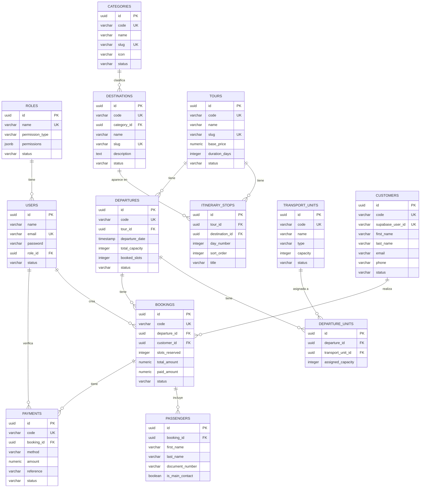
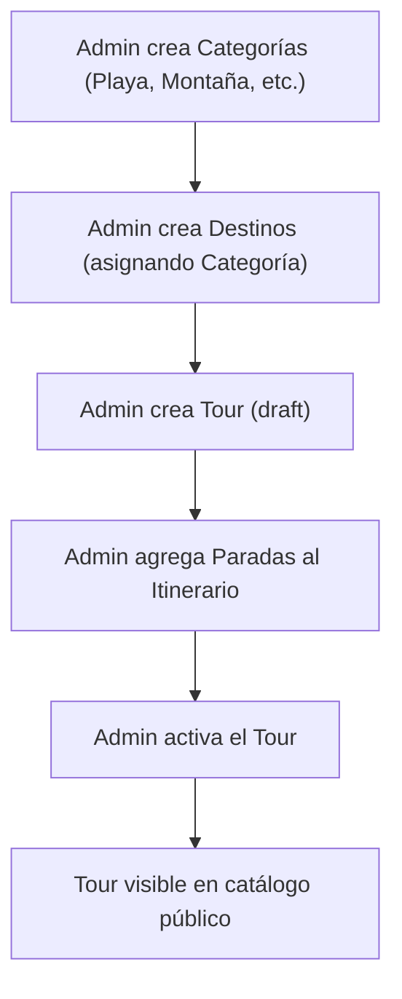
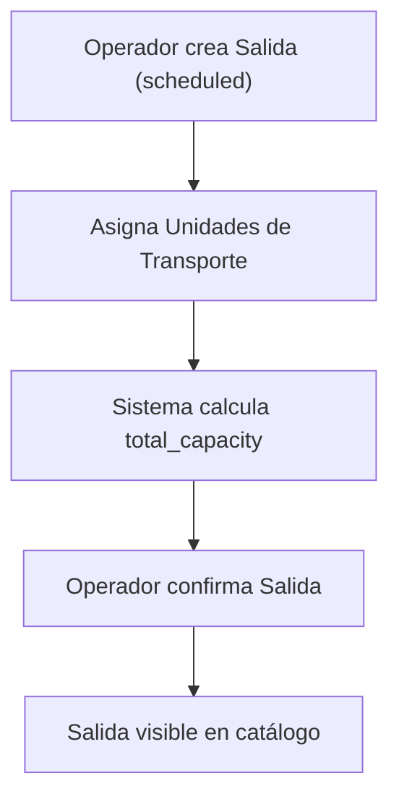
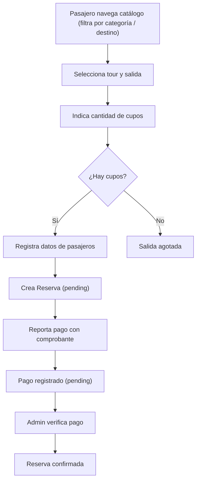
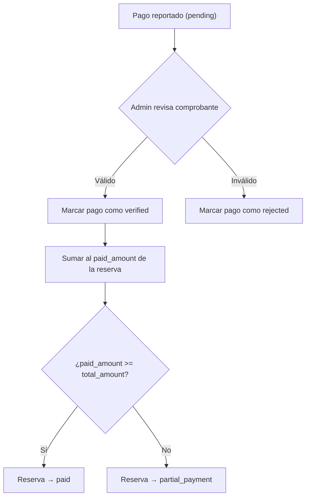
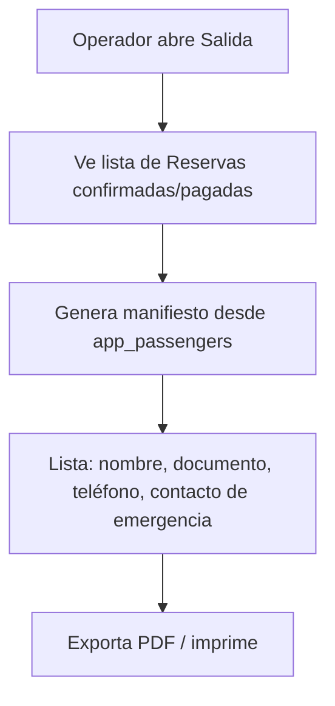

# Arquitectura MVP — Plataforma Digital para Agencias de Viajes

## Índice

1. [Visión General](#1-visión-general)
2. [Stack Tecnológico](#2-stack-tecnológico)
3. [Arquitectura de Autenticación](#3-arquitectura-de-autenticación)
4. [Estructura de Route Groups](#4-estructura-de-route-groups)
5. [Módulos del Sistema](#5-módulos-del-sistema)
6. [Modelo de Datos (Drizzle ORM)](#6-modelo-de-datos-drizzle-orm)
7. [Diagrama Entidad-Relación](#7-diagrama-entidad-relación)
8. [Roles y Permisos](#8-roles-y-permisos)
9. [Flujos de Negocio](#9-flujos-de-negocio)
10. [Reglas de Negocio](#10-reglas-de-negocio)
11. [Fases de Desarrollo](#11-fases-de-desarrollo)

---

## 1. Visión General

Sistema unificado bajo **Next.js App Router** con dos entornos aislados:

| Entorno                  | Route Group  | Audiencia            | Auth Provider                          |
|--------------------------|--------------|----------------------|----------------------------------------|
| **Portal del Cliente**   | `(catalogo)` | Pasajeros / público  | Supabase Auth (Gmail, Email, Teléfono) |
| **Panel Administrativo** | `(admin)`    | Equipo de la agencia | better-auth (email + password)         |

Ambos comparten la misma base de datos PostgreSQL pero tienen sesiones, layouts y middleware completamente separados.

---

## 2. Stack Tecnológico

| Capa            | Tecnología                                                  |
|-----------------|-------------------------------------------------------------|
| Framework       | Next.js 16 (App Router)                                     |
| Lenguaje        | TypeScript 5                                                |
| Runtime         | Node.js                                                     |
| Base de datos   | Supabase                                                    |
| ORM             | Drizzle ORM                                                 |
| Auth (Admin)    | better-auth (email + password, roles en tabla `user`)       |
| Auth (Cliente)  | Supabase Auth (OAuth Gmail, Magic Link email, OTP teléfono) |
| Validación      | Zod                                                         |
| UI              | Tailwind CSS v4 + shadcn/ui                                 |
| Testing         | Vitest + Playwright                                         |
| Package Manager | pnpm                                                        |

---

## 3. Arquitectura de Autenticación

### 3.1 Portal del Cliente — Supabase Auth

Supabase gestiona todo el ciclo de autenticación del pasajero. Los métodos disponibles son:

| Método       | Proveedor          | Descripción                                    |
|--------------|--------------------|------------------------------------------------|
| **Gmail**    | OAuth 2.0 (Google) | Login con un clic vía cuenta de Google         |
| **Email**    | Magic Link         | Enlace de acceso enviado al correo electrónico |

**Flujo:**

1. El pasajero accede a `(catalogo)/cuenta/login`
2. Selecciona su método de autenticación preferido
3. Supabase emite un JWT
4. El middleware de `(catalogo)` valida el JWT de Supabase para rutas protegidas (`/cuenta/*`)
5. El `supabase_user_id` se vincula con la tabla `app_customers` del sistema

**Configuración requerida:**

- Variables de entorno: `NEXT_PUBLIC_SUPABASE_URL`, `NEXT_PUBLIC_SUPABASE_ANON_KEY`, `SUPABASE_SERVICE_ROLE_KEY`
- Configurar proveedores OAuth (Google) en el dashboard de Supabase

### 3.2 Panel Administrativo — better-auth

El panel admin utiliza better-auth con autenticación tradicional email + contraseña.

| Aspecto  | Detalle                                                             |
|----------|---------------------------------------------------------------------|
| Registro | Solo por invitación (un admin crea las cuentas)                     |
| Login    | Email + contraseña                                                  |
| Sesión   | Cookie HTTP-only, gestionada por better-auth                        |
| Roles    | `admin`, `operator`, `sales_agent` (columna `role` en tabla `user`) |

**Flujo:**

1. El usuario accede a `(admin)/admin/login`
2. Envía credenciales (email + password)
3. better-auth valida y crea la sesión
4. El middleware de `(admin)` verifica la sesión de better-auth y el rol del usuario

---

## 4. Estructura de Route Groups

```
src/
├── app/
│   ├── (catalogo)/                         # Portal del cliente
│   │   ├── layout.tsx                      # Layout público + Supabase Provider
│   │   ├── page.tsx                        # Landing page / buscador de tours
│   │   ├── tours/
│   │   │   ├── page.tsx                    # Directorio general de salidas
│   │   │   └── [slug]/page.tsx             # Ficha detallada del destino
│   │   ├── reservar/[id]/page.tsx          # Checkout y reporte de pago
│   │   └── cuenta/                         # Área privada del pasajero (requiere Supabase Auth)
│   │       ├── login/page.tsx              # Login Supabase (Gmail, Email, Teléfono)
│   │       └── reservas/page.tsx           # Mis reservas, vouchers y estatus de abonos
│   │
│   ├── (admin)/                            # Panel operativo interno
│   │   ├── layout.tsx                      # Layout admin + requireAuth() + sidebar
│   │   └── admin/
│   │       ├── login/page.tsx              # Login better-auth (email + password)
│   │       ├── page.tsx                    # Dashboard general
│   │       ├── categories/page.tsx         # CRUD de categorías de destinos
│   │       ├── destinations/page.tsx       # CRUD de destinos
│   │       ├── tours/page.tsx              # Creación y control de salidas
│   │       ├── departures/page.tsx         # Programación de salidas específicas
│   │       ├── transport-units/page.tsx    # Gestión de unidades de transporte
│   │       ├── bookings/page.tsx           # Auditoría de reservas y manifiestos
│   │       ├── payments/page.tsx           # Conciliación de comprobantes
│   │       ├── customers/page.tsx          # Directorio CRM de pasajeros
│   │       ├── users/page.tsx              # Gestión de usuarios admin
│   │       └── roles/page.tsx              # Gestión de roles y permisos
│   │
│   └── api/                                # Endpoints auxiliares (webhooks, etc.)
│       └── auth/                           # Callbacks de Supabase / better-auth
│
├── middleware.ts                            # Separación de sesiones (catalogo) vs (admin)
│
└── modules/                                # Lógica de negocio (arquitectura modular)
    ├── shared/                             # Infraestructura compartida
    ├── user/                               # Usuarios admin (better-auth)
    ├── role/                               # Roles y permisos
    ├── category/                           # Categorías de destinos (playa, montaña, río, etc.)
    ├── destination/                        # Destinos turísticos
    ├── tour/                               # Tours / experiencias
    ├── itinerary-stop/                     # Paradas del itinerario
    ├── departure/                          # Salidas programadas
    ├── transport-unit/                     # Unidades de transporte
    ├── departure-unit/                     # Asignación unidad ↔ salida
    ├── customer/                           # Pasajeros / clientes
    ├── booking/                            # Reservas
    ├── passenger/                          # Pasajeros individuales por reserva
    └── payment/                            # Pagos y comprobantes
```

---

## 5. Módulos del Sistema

### 5.1 Módulos del Panel Administrativo

| #  | Módulo             | Slug              | Descripción                                                    |
|----|--------------------|-------------------|----------------------------------------------------------------|
| 1  | **User**           | `users`           | Gestión de cuentas del equipo administrativo (better-auth)     |
| 2  | **Role**           | `roles`           | Roles y permisos granulares                                    |
| 3  | **Category**       | `categories`      | Categorías de destinos turísticos (Playa, Montaña, Río, etc.)  |
| 4  | **Destination**    | `destinations`    | Catálogo de destinos turísticos                                |
| 5  | **Tour**           | `tours`           | Experiencias / paquetes turísticos con itinerario multi-parada |
| 6  | **Itinerary Stop** | `itinerary-stops` | Paradas del itinerario de un tour                              |
| 7  | **Departure**      | `departures`      | Salidas programadas (fecha, hora, cupos)                       |
| 8  | **Transport Unit** | `transport-units` | Autobuses, vans, lanchas (con capacidad)                       |
| 9  | **Departure Unit** | `departure-units` | Asignación de unidades de transporte a una salida              |
| 10 | **Customer**       | `customers`       | Directorio CRM de pasajeros                                    |
| 11 | **Booking**        | `bookings`        | Reservas de pasajeros con control de cupos                     |
| 12 | **Passenger**      | `passengers`      | Pasajeros individuales registrados en una reserva              |
| 13 | **Payment**        | `payments`        | Comprobantes de pago y conciliación                            |

### 5.2 Módulos del Portal del Cliente

El portal del cliente no tiene módulos backend propios. Consume los mismos módulos de la sección admin pero con:

- Servicios de solo lectura (Search/Find) para tours, destinos, categorías y salidas (filtros y catálogo)
- Servicios de escritura limitados para bookings y payments (solo crear, solo los propios)
- Todo filtrado por el `customer_id` vinculado al `supabase_user_id`

---

## 6. Modelo de Datos (Drizzle ORM)

> Todas las tablas usan el prefijo `app_`, UUID v7 como PK, `status` como `varchar(50)` (nunca `pgEnum`), timestamps con
> timezone, y cumplen la política de **no eliminación física**.

---

### 6.1 `app_users` — Usuarios administrativos

Tabla gestionada por better-auth. Se extiende con campos adicionales para el sistema.

```ts
// src/modules/user/models/user.model.ts
export const users = pgTable('app_users', {
    id: uuid('id').primaryKey(),
    name: varchar('name', {length: 255}).notNull(),
    email: varchar('email', {length: 255}).notNull().unique(),
    password: varchar('password', {length: 255}).notNull(),
    roleId: uuid('role_id').notNull().references(() => roles.id),
    phone: varchar('phone', {length: 50}),
    avatarUrl: varchar('avatar_url', {length: 500}),
    status: varchar('status', {length: 50}).notNull().default('active')
        .$type<'active' | 'inactive'>(),
    lastLoginAt: timestamp('last_login_at', {withTimezone: true}),
    createdAt: timestamp('created_at', {withTimezone: true}).notNull().defaultNow(),
    updatedAt: timestamp('updated_at', {withTimezone: true}).defaultNow()
        .$onUpdate(() => new Date()),
});
```

| Columna         | Tipo                    | Nullable | Default    | Descripción                |
|-----------------|-------------------------|----------|------------|----------------------------|
| `id`            | `uuid` PK               | No       | —          | UUID v7                    |
| `name`          | `varchar(255)`          | No       | —          | Nombre completo            |
| `email`         | `varchar(255)` UNIQUE   | No       | —          | Correo electrónico (login) |
| `password`      | `varchar(255)`          | No       | —          | Hash de la contraseña      |
| `role_id`       | `uuid` FK → `app_roles` | No       | —          | Rol asignado               |
| `phone`         | `varchar(50)`           | Sí       | —          | Teléfono de contacto       |
| `avatar_url`    | `varchar(500)`          | Sí       | —          | URL del avatar             |
| `status`        | `varchar(50)`           | No       | `'active'` | `active` \| `inactive`     |
| `last_login_at` | `timestamptz`           | Sí       | —          | Último inicio de sesión    |
| `created_at`    | `timestamptz`           | No       | `now()`    | Fecha de creación          |
| `updated_at`    | `timestamptz`           | Sí       | `now()`    | Última actualización       |

---

### 6.2 `app_roles` — Roles del sistema

```ts
// src/modules/role/models/role.model.ts
export const roles = pgTable('app_roles', {
    id: uuid('id').primaryKey(),
    name: varchar('name', {length: 100}).notNull().unique(),
    description: varchar('description', {length: 255}),
    permissionType: varchar('permission_type', {length: 50}).notNull().default('custom')
        .$type<'all' | 'custom'>(),
    permissions: jsonb('permissions').$type<string[]>().notNull().default([]),
    status: varchar('status', {length: 50}).notNull().default('active')
        .$type<'active' | 'inactive'>(),
    createdAt: timestamp('created_at', {withTimezone: true}).notNull().defaultNow(),
    updatedAt: timestamp('updated_at', {withTimezone: true}).defaultNow()
        .$onUpdate(() => new Date()),
});
```

| Columna           | Tipo                  | Nullable | Default    | Descripción                                                   |
|-------------------|-----------------------|----------|------------|---------------------------------------------------------------|
| `id`              | `uuid` PK             | No       | —          | UUID v7                                                       |
| `name`            | `varchar(100)` UNIQUE | No       | —          | Nombre del rol (`Admin`, `Operador`, `Agente de Ventas`)      |
| `description`     | `varchar(255)`        | Sí       | —          | Descripción del rol                                           |
| `permission_type` | `varchar(50)`         | No       | `'custom'` | `all` = superadmin, `custom` = permisos específicos           |
| `permissions`     | `jsonb` (string[])    | No       | `[]`       | Array de permission IDs (`['tours.list','tours.create',...]`) |
| `status`          | `varchar(50)`         | No       | `'active'` | `active` \| `inactive`                                        |
| `created_at`      | `timestamptz`         | No       | `now()`    | Fecha de creación                                             |
| `updated_at`      | `timestamptz`         | Sí       | `now()`    | Última actualización                                          |

**Roles por defecto del MVP:**

| Rol                  | `permission_type` | Acceso                                                                            |
|----------------------|-------------------|-----------------------------------------------------------------------------------|
| **Admin**            | `all`             | Acceso total a todos los módulos                                                  |
| **Operador**         | `custom`          | Gestiona tours, salidas, reservas, pagos, clientes. No gestiona usuarios ni roles |
| **Agente de Ventas** | `custom`          | Solo crea reservas y registra pagos. Ve tours y salidas en modo lectura           |

---

### 6.3 `app_categories` — Categorías de destinos

```ts
// src/modules/category/models/category.model.ts
export const categories = pgTable('app_categories', {
    id: uuid('id').primaryKey(),
    code: varchar('code', {length: 20}).notNull().unique(),
    name: varchar('name', {length: 100}).notNull(),
    slug: varchar('slug', {length: 100}).notNull().unique(),
    description: text('description'),
    icon: varchar('icon', {length: 100}),
    imageUrl: varchar('image_url', {length: 500}),
    status: varchar('status', {length: 50}).notNull().default('active')
        .$type<'active' | 'inactive'>(),
    createdAt: timestamp('created_at', {withTimezone: true}).notNull().defaultNow(),
    updatedAt: timestamp('updated_at', {withTimezone: true}).defaultNow()
        .$onUpdate(() => new Date()),
});
```

| Columna       | Tipo                  | Nullable | Default    | Descripción                                        |
|---------------|-----------------------|----------|------------|----------------------------------------------------|
| `id`          | `uuid` PK             | No       | —          | UUID v7                                            |
| `code`        | `varchar(20)` UNIQUE  | No       | —          | Código secuencial (`CAT000001`)                    |
| `name`        | `varchar(100)`        | No       | —          | Nombre (ej: "Playa", "Montaña", "Río", "Selva")    |
| `slug`        | `varchar(100)` UNIQUE | No       | —          | Slug URL-friendly (`playa`, `montana`, `rio`)      |
| `description` | `text`                | Sí       | —          | Descripción opcional de la categoría               |
| `icon`        | `varchar(100)`        | Sí       | —          | Identificador de icono (ej: Lucide `waves`, `mountain`) |
| `image_url`   | `varchar(500)`        | Sí       | —          | Imagen representativa para filtros visuales        |
| `status`      | `varchar(50)`         | No       | `'active'` | `active` \| `inactive`                             |
| `created_at`  | `timestamptz`         | No       | `now()`    | —                                                  |
| `updated_at`  | `timestamptz`         | Sí       | `now()`    | —                                                  |

---

### 6.4 `app_destinations` — Destinos turísticos

```ts
// src/modules/destination/models/destination.model.ts
export const destinations = pgTable('app_destinations', {
    id: uuid('id').primaryKey(),
    code: varchar('code', {length: 20}).notNull().unique(),
    categoryId: uuid('category_id').references(() => categories.id),
    name: varchar('name', {length: 255}).notNull(),
    slug: varchar('slug', {length: 255}).notNull().unique(),
    description: text('description'),
    imageUrl: varchar('image_url', {length: 500}),
    state: varchar('state', {length: 100}),
    city: varchar('city', {length: 100}),
    country: varchar('country', {length: 100}).notNull().default('Venezuela'),
    status: varchar('status', {length: 50}).notNull().default('active')
        .$type<'active' | 'inactive'>(),
    createdAt: timestamp('created_at', {withTimezone: true}).notNull().defaultNow(),
    updatedAt: timestamp('updated_at', {withTimezone: true}).defaultNow()
        .$onUpdate(() => new Date()),
});
```

| Columna       | Tipo                       | Nullable | Default       | Descripción                                    |
|---------------|----------------------------|----------|---------------|------------------------------------------------|
| `id`          | `uuid` PK                  | No       | —             | UUID v7                                        |
| `code`        | `varchar(20)` UNIQUE       | No       | —             | Código secuencial (`DES000001`)                |
| `category_id` | `uuid` FK → `app_categories`| Sí      | —             | Categoría asignada (Playa, Montaña, Río, etc.)  |
| `name`        | `varchar(255)`             | No       | —             | Nombre del destino (ej: "Los Roques")          |
| `slug`        | `varchar(255)` UNIQUE      | No       | —             | Slug URL-friendly (`los-roques`)               |
| `description` | `text`                     | Sí       | —             | Descripción para el catálogo público           |
| `image_url`   | `varchar(500)`             | Sí       | —             | Imagen principal                               |
| `state`       | `varchar(100)`             | Sí       | —             | Estado/provincia                               |
| `city`        | `varchar(100)`             | Sí       | —             | Ciudad                                         |
| `country`     | `varchar(100)`             | No       | `'Venezuela'` | País                                           |
| `status`      | `varchar(50)`              | No       | `'active'`    | `active` \| `inactive`                         |
| `created_at`  | `timestamptz`              | No       | `now()`       | —                                              |
| `updated_at`  | `timestamptz`              | Sí       | `now()`       | —                                              |

---

### 6.5 `app_tours` — Tours / Experiencias

```ts
// src/modules/tour/models/tour.model.ts
export const tours = pgTable('app_tours', {
    id: uuid('id').primaryKey(),
    code: varchar('code', {length: 20}).notNull().unique(),
    name: varchar('name', {length: 255}).notNull(),
    slug: varchar('slug', {length: 255}).notNull().unique(),
    description: text('description'),
    shortDescription: varchar('short_description', {length: 500}),
    imageUrl: varchar('image_url', {length: 500}),
    durationDays: integer('duration_days').notNull().default(1),
    basePrice: numeric('base_price', {precision: 12, scale: 2}).notNull(),
    currency: varchar('currency', {length: 10}).notNull().default('USD'),
    includesFood: boolean('includes_food').notNull().default(false),
    includesLodging: boolean('includes_lodging').notNull().default(false),
    inclusions: text('inclusions'),
    exclusions: text('exclusions'),
    status: varchar('status', {length: 50}).notNull().default('draft')
        .$type<'draft' | 'active' | 'inactive'>(),
    createdAt: timestamp('created_at', {withTimezone: true}).notNull().defaultNow(),
    updatedAt: timestamp('updated_at', {withTimezone: true}).defaultNow()
        .$onUpdate(() => new Date()),
});
```

| Columna             | Tipo                  | Nullable | Default   | Descripción                                    |
|---------------------|-----------------------|----------|-----------|------------------------------------------------|
| `id`                | `uuid` PK             | No       | —         | UUID v7                                        |
| `code`              | `varchar(20)` UNIQUE  | No       | —         | Código secuencial (`TUR000001`)                |
| `name`              | `varchar(255)`        | No       | —         | Nombre del tour (ej: "Aventura en Los Roques") |
| `slug`              | `varchar(255)` UNIQUE | No       | —         | Slug URL-friendly                              |
| `description`       | `text`                | Sí       | —         | Descripción completa (catálogo)                |
| `short_description` | `varchar(500)`        | Sí       | —         | Resumen corto (tarjetas)                       |
| `image_url`         | `varchar(500)`        | Sí       | —         | Imagen principal del tour                      |
| `duration_days`     | `integer`             | No       | `1`       | Duración en días                               |
| `base_price`        | `numeric(12,2)`       | No       | —         | Precio base por persona en USD                 |
| `currency`          | `varchar(10)`         | No       | `'USD'`   | Moneda del precio                              |
| `includes_food`     | `boolean`             | No       | `false`   | ¿Incluye alimentación?                         |
| `includes_lodging`  | `boolean`             | No       | `false`   | ¿Incluye hospedaje?                            |
| `inclusions`        | `text`                | Sí       | —         | Lo que incluye (texto libre)                   |
| `exclusions`        | `text`                | Sí       | —         | Lo que no incluye                              |
| `status`            | `varchar(50)`         | No       | `'draft'` | `draft` \| `active` \| `inactive`              |
| `created_at`        | `timestamptz`         | No       | `now()`   | —                                              |
| `updated_at`        | `timestamptz`         | Sí       | `now()`   | —                                              |

---

### 6.6 `app_itinerary_stops` — Paradas del itinerario

```ts
// src/modules/itinerary-stop/models/itinerary-stop.model.ts
export const itineraryStops = pgTable('app_itinerary_stops', {
    id: uuid('id').primaryKey().$defaultFn(uuidv7),
    tourId: uuid('tour_id').notNull().references(() => tours.id),
    destinationId: uuid('destination_id').notNull().references(() => destinations.id),
    dayNumber: integer('day_number').notNull(),
    sortOrder: integer('sort_order').notNull(),
    title: varchar('title', {length: 255}).notNull(),
    description: text('description'),
    overnightStay: boolean('overnight_stay').notNull().default(false),
    createdAt: timestamp('created_at', {withTimezone: true}).notNull().defaultNow(),
    updatedAt: timestamp('updated_at', {withTimezone: true}).defaultNow()
        .$onUpdate(() => new Date()),
});
```

| Columna          | Tipo                           | Nullable | Default    | Descripción                                  |
|------------------|--------------------------------|----------|------------|----------------------------------------------|
| `id`             | `uuid` PK                      | No       | `uuidv7()` | Server-generated (entidad hija)              |
| `tour_id`        | `uuid` FK → `app_tours`        | No       | —          | Tour al que pertenece                        |
| `destination_id` | `uuid` FK → `app_destinations` | No       | —          | Destino de esta parada                       |
| `day_number`     | `integer`                      | No       | —          | Día del itinerario (1, 2, 3...)              |
| `sort_order`     | `integer`                      | No       | —          | Orden dentro del día                         |
| `title`          | `varchar(255)`                 | No       | —          | Título de la parada (ej: "Llegada a Mérida") |
| `description`    | `text`                         | Sí       | —          | Descripción de la actividad                  |
| `overnight_stay` | `boolean`                      | No       | `false`    | ¿Se pernocta en esta parada?                 |
| `created_at`     | `timestamptz`                  | No       | `now()`    | —                                            |
| `updated_at`     | `timestamptz`                  | Sí       | `now()`    | —                                            |

---

### 6.7 `app_transport_units` — Unidades de transporte

```ts
// src/modules/transport-unit/models/transport-unit.model.ts
export const transportUnits = pgTable('app_transport_units', {
    id: uuid('id').primaryKey(),
    code: varchar('code', {length: 20}).notNull().unique(),
    name: varchar('name', {length: 255}).notNull(),
    type: varchar('type', {length: 50}).notNull()
        .$type<'bus' | 'minibus' | 'van' | 'boat' | 'other'>(),
    plateNumber: varchar('plate_number', {length: 20}),
    capacity: integer('capacity').notNull(),
    driverName: varchar('driver_name', {length: 255}),
    driverPhone: varchar('driver_phone', {length: 50}),
    notes: text('notes'),
    status: varchar('status', {length: 50}).notNull().default('active')
        .$type<'active' | 'inactive' | 'maintenance'>(),
    createdAt: timestamp('created_at', {withTimezone: true}).notNull().defaultNow(),
    updatedAt: timestamp('updated_at', {withTimezone: true}).defaultNow()
        .$onUpdate(() => new Date()),
});
```

| Columna        | Tipo                 | Nullable | Default    | Descripción                                      |
|----------------|----------------------|----------|------------|--------------------------------------------------|
| `id`           | `uuid` PK            | No       | —          | UUID v7                                          |
| `code`         | `varchar(20)` UNIQUE | No       | —          | Código secuencial (`UNI000001`)                  |
| `name`         | `varchar(255)`       | No       | —          | Nombre identificador (ej: "Bus Premium 01")      |
| `type`         | `varchar(50)`        | No       | —          | `bus` \| `minibus` \| `van` \| `boat` \| `other` |
| `plate_number` | `varchar(20)`        | Sí       | —          | Placa del vehículo                               |
| `capacity`     | `integer`            | No       | —          | Capacidad total de pasajeros                     |
| `driver_name`  | `varchar(255)`       | Sí       | —          | Nombre del chofer                                |
| `driver_phone` | `varchar(50)`        | Sí       | —          | Teléfono del chofer                              |
| `notes`        | `text`               | Sí       | —          | Notas internas                                   |
| `status`       | `varchar(50)`        | No       | `'active'` | `active` \| `inactive` \| `maintenance`          |
| `created_at`   | `timestamptz`        | No       | `now()`    | —                                                |
| `updated_at`   | `timestamptz`        | Sí       | `now()`    | —                                                |

---

### 6.8 `app_departures` — Salidas programadas

```ts
// src/modules/departure/models/departure.model.ts
export const departures = pgTable('app_departures', {
    id: uuid('id').primaryKey(),
    code: varchar('code', {length: 20}).notNull().unique(),
    tourId: uuid('tour_id').notNull().references(() => tours.id),
    departureDate: timestamp('departure_date', {withTimezone: true}).notNull(),
    returnDate: timestamp('return_date', {withTimezone: true}),
    meetingPoint: varchar('meeting_point', {length: 255}),
    meetingTime: varchar('meeting_time', {length: 10}),
    priceOverride: numeric('price_override', {precision: 12, scale: 2}),
    totalCapacity: integer('total_capacity').notNull(),
    bookedSlots: integer('booked_slots').notNull().default(0),
    notes: text('notes'),
    status: varchar('status', {length: 50}).notNull().default('scheduled')
        .$type<'scheduled' | 'confirmed' | 'in_progress' | 'completed' | 'cancelled'>(),
    createdAt: timestamp('created_at', {withTimezone: true}).notNull().defaultNow(),
    updatedAt: timestamp('updated_at', {withTimezone: true}).defaultNow()
        .$onUpdate(() => new Date()),
});
```

| Columna          | Tipo                    | Nullable | Default       | Descripción                                                               |
|------------------|-------------------------|----------|---------------|---------------------------------------------------------------------------|
| `id`             | `uuid` PK               | No       | —             | UUID v7                                                                   |
| `code`           | `varchar(20)` UNIQUE    | No       | —             | Código secuencial (`SAL000001`)                                           |
| `tour_id`        | `uuid` FK → `app_tours` | No       | —             | Tour asociado                                                             |
| `departure_date` | `timestamptz`           | No       | —             | Fecha y hora de salida                                                    |
| `return_date`    | `timestamptz`           | Sí       | —             | Fecha estimada de regreso                                                 |
| `meeting_point`  | `varchar(255)`          | Sí       | —             | Punto de encuentro                                                        |
| `meeting_time`   | `varchar(10)`           | Sí       | —             | Hora de encuentro (ej: "06:30")                                           |
| `price_override` | `numeric(12,2)`         | Sí       | —             | Precio especial (si difiere del tour base)                                |
| `total_capacity` | `integer`               | No       | —             | Cupos totales (suma de capacidades de unidades asignadas)                 |
| `booked_slots`   | `integer`               | No       | `0`           | Cupos reservados (se incrementa con cada reserva confirmada)              |
| `notes`          | `text`                  | Sí       | —             | Notas internas                                                            |
| `status`         | `varchar(50)`           | No       | `'scheduled'` | `scheduled` \| `confirmed` \| `in_progress` \| `completed` \| `cancelled` |
| `created_at`     | `timestamptz`           | No       | `now()`       | —                                                                         |
| `updated_at`     | `timestamptz`           | Sí       | `now()`       | —                                                                         |

**Cupos disponibles** = `total_capacity - booked_slots`

---

### 6.9 `app_departure_units` — Asignación unidad ↔ salida (pivote)

```ts
// src/modules/departure-unit/models/departure-unit.model.ts
export const departureUnits = pgTable('app_departure_units', {
    id: uuid('id').primaryKey().$defaultFn(uuidv7),
    departureId: uuid('departure_id').notNull().references(() => departures.id),
    transportUnitId: uuid('transport_unit_id').notNull().references(() => transportUnits.id),
    assignedCapacity: integer('assigned_capacity').notNull(),
    driverNameOverride: varchar('driver_name_override', {length: 255}),
    driverPhoneOverride: varchar('driver_phone_override', {length: 50}),
    notes: text('notes'),
    createdAt: timestamp('created_at', {withTimezone: true}).notNull().defaultNow(),
});
```

| Columna                 | Tipo                              | Nullable | Default    | Descripción                                                 |
|-------------------------|-----------------------------------|----------|------------|-------------------------------------------------------------|
| `id`                    | `uuid` PK                         | No       | `uuidv7()` | Server-generated (pivote)                                   |
| `departure_id`          | `uuid` FK → `app_departures`      | No       | —          | Salida                                                      |
| `transport_unit_id`     | `uuid` FK → `app_transport_units` | No       | —          | Unidad de transporte                                        |
| `assigned_capacity`     | `integer`                         | No       | —          | Cupos asignados de esta unidad para esta salida             |
| `driver_name_override`  | `varchar(255)`                    | Sí       | —          | Chofer específico para esta salida (si difiere del default) |
| `driver_phone_override` | `varchar(50)`                     | Sí       | —          | Teléfono del chofer para esta salida                        |
| `notes`                 | `text`                            | Sí       | —          | Notas                                                       |
| `created_at`            | `timestamptz`                     | No       | `now()`    | —                                                           |

> Una salida puede tener **1 o más** unidades de transporte asignadas. La `total_capacity` de la salida es la suma de
> `assigned_capacity` de todas sus unidades.

---

### 6.10 `app_customers` — Pasajeros / Clientes (CRM)

```ts
// src/modules/customer/models/customer.model.ts
export const customers = pgTable('app_customers', {
    id: uuid('id').primaryKey(),
    code: varchar('code', {length: 20}).notNull().unique(),
    supabaseUserId: varchar('supabase_user_id', {length: 255}).unique(),
    firstName: varchar('first_name', {length: 255}).notNull(),
    lastName: varchar('last_name', {length: 255}).notNull(),
    email: varchar('email', {length: 255}),
    phone: varchar('phone', {length: 50}),
    documentType: varchar('document_type', {length: 20})
        .$type<'cedula' | 'passport' | 'other'>(),
    documentNumber: varchar('document_number', {length: 50}),
    birthDate: timestamp('birth_date', {withTimezone: true}),
    emergencyContact: varchar('emergency_contact', {length: 255}),
    emergencyPhone: varchar('emergency_phone', {length: 50}),
    notes: text('notes'),
    source: varchar('source', {length: 50}).notNull().default('admin')
        .$type<'admin' | 'portal' | 'whatsapp' | 'instagram'>(),
    status: varchar('status', {length: 50}).notNull().default('active')
        .$type<'active' | 'inactive'>(),
    createdAt: timestamp('created_at', {withTimezone: true}).notNull().defaultNow(),
    updatedAt: timestamp('updated_at', {withTimezone: true}).defaultNow()
        .$onUpdate(() => new Date()),
});
```

| Columna             | Tipo                  | Nullable | Default    | Descripción                                          |
|---------------------|-----------------------|----------|------------|------------------------------------------------------|
| `id`                | `uuid` PK             | No       | —          | UUID v7                                              |
| `code`              | `varchar(20)` UNIQUE  | No       | —          | Código secuencial (`CLI000001`)                      |
| `supabase_user_id`  | `varchar(255)` UNIQUE | Sí       | —          | ID del usuario en Supabase Auth (vinculación portal) |
| `first_name`        | `varchar(255)`        | No       | —          | Nombre                                               |
| `last_name`         | `varchar(255)`        | No       | —          | Apellido                                             |
| `email`             | `varchar(255)`        | Sí       | —          | Correo electrónico                                   |
| `phone`             | `varchar(50)`         | Sí       | —          | Teléfono                                             |
| `document_type`     | `varchar(20)`         | Sí       | —          | `cedula` \| `passport` \| `other`                    |
| `document_number`   | `varchar(50)`         | Sí       | —          | Número de documento                                  |
| `birth_date`        | `timestamptz`         | Sí       | —          | Fecha de nacimiento                                  |
| `emergency_contact` | `varchar(255)`        | Sí       | —          | Nombre del contacto de emergencia                    |
| `emergency_phone`   | `varchar(50)`         | Sí       | —          | Teléfono de emergencia                               |
| `notes`             | `text`                | Sí       | —          | Notas internas CRM                                   |
| `source`            | `varchar(50)`         | No       | `'admin'`  | Canal de adquisición                                 |
| `status`            | `varchar(50)`         | No       | `'active'` | `active` \| `inactive`                               |
| `created_at`        | `timestamptz`         | No       | `now()`    | —                                                    |
| `updated_at`        | `timestamptz`         | Sí       | `now()`    | —                                                    |

---

### 6.11 `app_bookings` — Reservas

```ts
// src/modules/booking/models/booking.model.ts
export const bookings = pgTable('app_bookings', {
    id: uuid('id').primaryKey(),
    code: varchar('code', {length: 20}).notNull().unique(),
    departureId: uuid('departure_id').notNull().references(() => departures.id),
    customerId: uuid('customer_id').notNull().references(() => customers.id),
    slotsReserved: integer('slots_reserved').notNull(),
    totalAmount: numeric('total_amount', {precision: 12, scale: 2}).notNull(),
    paidAmount: numeric('paid_amount', {precision: 12, scale: 2}).notNull().default('0'),
    notes: text('notes'),
    source: varchar('source', {length: 50}).notNull().default('admin')
        .$type<'admin' | 'portal'>(),
    createdById: uuid('created_by_id').references(() => users.id),
    status: varchar('status', {length: 50}).notNull().default('pending')
        .$type<'pending' | 'confirmed' | 'partial_payment' | 'paid' | 'cancelled'>(),
    createdAt: timestamp('created_at', {withTimezone: true}).notNull().defaultNow(),
    updatedAt: timestamp('updated_at', {withTimezone: true}).defaultNow()
        .$onUpdate(() => new Date()),
});
```

| Columna          | Tipo                         | Nullable | Default     | Descripción                                                            |
|------------------|------------------------------|----------|-------------|------------------------------------------------------------------------|
| `id`             | `uuid` PK                    | No       | —           | UUID v7                                                                |
| `code`           | `varchar(20)` UNIQUE         | No       | —           | Código secuencial (`RES000001`)                                        |
| `departure_id`   | `uuid` FK → `app_departures` | No       | —           | Salida reservada                                                       |
| `customer_id`    | `uuid` FK → `app_customers`  | No       | —           | Cliente que reserva                                                    |
| `slots_reserved` | `integer`                    | No       | —           | Cantidad de cupos reservados                                           |
| `total_amount`   | `numeric(12,2)`              | No       | —           | Monto total de la reserva (USD)                                        |
| `paid_amount`    | `numeric(12,2)`              | No       | `0`         | Monto pagado hasta ahora                                               |
| `notes`          | `text`                       | Sí       | —           | Notas sobre la reserva                                                 |
| `source`         | `varchar(50)`                | No       | `'admin'`   | Origen: `admin` (operador creó) \| `portal` (pasajero reservó online)  |
| `created_by_id`  | `uuid` FK → `app_users`      | Sí       | —           | Usuario admin que creó la reserva (null si fue portal)                 |
| `status`         | `varchar(50)`                | No       | `'pending'` | `pending` \| `confirmed` \| `partial_payment` \| `paid` \| `cancelled` |
| `created_at`     | `timestamptz`                | No       | `now()`     | —                                                                      |
| `updated_at`     | `timestamptz`                | Sí       | `now()`     | —                                                                      |

**Estados de la reserva:**

```
pending → confirmed → partial_payment → paid
    ↓         ↓              ↓            ↓
 cancelled  cancelled     cancelled    (finalizada)
```

---

### 6.12 `app_passengers` — Pasajeros de una reserva

```ts
// src/modules/passenger/models/passenger.model.ts
export const passengers = pgTable('app_passengers', {
    id: uuid('id').primaryKey().$defaultFn(uuidv7),
    bookingId: uuid('booking_id').notNull().references(() => bookings.id),
    firstName: varchar('first_name', {length: 255}).notNull(),
    lastName: varchar('last_name', {length: 255}).notNull(),
    documentType: varchar('document_type', {length: 20})
        .$type<'cedula' | 'passport' | 'other'>(),
    documentNumber: varchar('document_number', {length: 50}),
    phone: varchar('phone', {length: 50}),
    isMainContact: boolean('is_main_contact').notNull().default(false),
    notes: text('notes'),
    createdAt: timestamp('created_at', {withTimezone: true}).notNull().defaultNow(),
    updatedAt: timestamp('updated_at', {withTimezone: true}).defaultNow()
        .$onUpdate(() => new Date()),
});
```

| Columna           | Tipo                       | Nullable | Default    | Descripción                              |
|-------------------|----------------------------|----------|------------|------------------------------------------|
| `id`              | `uuid` PK                  | No       | `uuidv7()` | Server-generated (entidad hija)          |
| `booking_id`      | `uuid` FK → `app_bookings` | No       | —          | Reserva a la que pertenece               |
| `first_name`      | `varchar(255)`             | No       | —          | Nombre del pasajero                      |
| `last_name`       | `varchar(255)`             | No       | —          | Apellido del pasajero                    |
| `document_type`   | `varchar(20)`              | Sí       | —          | Tipo de documento                        |
| `document_number` | `varchar(50)`              | Sí       | —          | Número de documento                      |
| `phone`           | `varchar(50)`              | Sí       | —          | Teléfono                                 |
| `is_main_contact` | `boolean`                  | No       | `false`    | ¿Es el contacto principal de la reserva? |
| `notes`           | `text`                     | Sí       | —          | Notas (alergias, necesidades especiales) |
| `created_at`      | `timestamptz`              | No       | `now()`    | —                                        |
| `updated_at`      | `timestamptz`              | Sí       | `now()`    | —                                        |

> Un booking con `slots_reserved = 3` debe tener exactamente 3 registros en `app_passengers`. El manifiesto de abordaje
> se genera a partir de esta tabla.

---

### 6.13 `app_payments` — Pagos y comprobantes

```ts
// src/modules/payment/models/payment.model.ts
export const payments = pgTable('app_payments', {
    id: uuid('id').primaryKey(),
    code: varchar('code', {length: 20}).notNull().unique(),
    bookingId: uuid('booking_id').notNull().references(() => bookings.id),
    method: varchar('method', {length: 50}).notNull()
        .$type<'pago_movil' | 'zelle' | 'binance' | 'zinli' | 'bank_transfer' | 'cash_usd' | 'cash_ves'>(),
    amount: numeric('amount', {precision: 12, scale: 2}).notNull(),
    currency: varchar('currency', {length: 10}).notNull().default('USD'),
    reference: varchar('reference', {length: 255}),
    proofImageUrl: varchar('proof_image_url', {length: 500}),
    paymentDate: timestamp('payment_date', {withTimezone: true}).notNull(),
    receivedByName: varchar('received_by_name', {length: 255}),
    verifiedById: uuid('verified_by_id').references(() => users.id),
    verifiedAt: timestamp('verified_at', {withTimezone: true}),
    notes: text('notes'),
    status: varchar('status', {length: 50}).notNull().default('pending')
        .$type<'pending' | 'verified' | 'rejected'>(),
    createdAt: timestamp('created_at', {withTimezone: true}).notNull().defaultNow(),
    updatedAt: timestamp('updated_at', {withTimezone: true}).defaultNow()
        .$onUpdate(() => new Date()),
});
```

| Columna            | Tipo                       | Nullable | Default     | Descripción                               |
|--------------------|----------------------------|----------|-------------|-------------------------------------------|
| `id`               | `uuid` PK                  | No       | —           | UUID v7                                   |
| `code`             | `varchar(20)` UNIQUE       | No       | —           | Código secuencial (`PAG000001`)           |
| `booking_id`       | `uuid` FK → `app_bookings` | No       | —           | Reserva asociada                          |
| `method`           | `varchar(50)`              | No       | —           | Método de pago                            |
| `amount`           | `numeric(12,2)`            | No       | —           | Monto del pago                            |
| `currency`         | `varchar(10)`              | No       | `'USD'`     | Moneda del pago                           |
| `reference`        | `varchar(255)`             | Sí       | —           | Referencia de la transacción              |
| `proof_image_url`  | `varchar(500)`             | Sí       | —           | URL del comprobante (captura de pantalla) |
| `payment_date`     | `timestamptz`              | No       | —           | Fecha en que se realizó el pago           |
| `received_by_name` | `varchar(255)`             | Sí       | —           | Nombre de quien recibió (efectivo)        |
| `verified_by_id`   | `uuid` FK → `app_users`    | Sí       | —           | Admin que verificó el pago                |
| `verified_at`      | `timestamptz`              | Sí       | —           | Fecha de verificación                     |
| `notes`            | `text`                     | Sí       | —           | Observaciones del pago                    |
| `status`           | `varchar(50)`              | No       | `'pending'` | `pending` \| `verified` \| `rejected`     |
| `created_at`       | `timestamptz`              | No       | `now()`     | —                                         |
| `updated_at`       | `timestamptz`              | Sí       | `now()`     | —                                         |

**Métodos de pago soportados:**

| Método                 | Clave           | Descripción                                         |
|------------------------|-----------------|-----------------------------------------------------|
| Pago Móvil             | `pago_movil`    | Transferencia interbancaria instantánea (Venezuela) |
| Zelle                  | `zelle`         | Transferencia bancaria (USA)                        |
| Binance                | `binance`       | Transferencia cripto P2P                            |
| Zinli                  | `zinli`         | Billetera digital                                   |
| Transferencia Bancaria | `bank_transfer` | Transferencia nacional/internacional                |
| Efectivo USD           | `cash_usd`      | Efectivo en dólares americanos                      |
| Efectivo VES           | `cash_ves`      | Efectivo en bolívares                               |

---

## 7. Diagrama Entidad-Relación



---

## 8. Roles y Permisos

### 8.1 Permisos por módulo

Cada módulo expone 5 permisos estándar:

| Permiso                  | Descripción                                 |
|--------------------------|---------------------------------------------|
| `{module}.list`          | Listar registros                            |
| `{module}.create`        | Crear registros                             |
| `{module}.show`          | Ver detalle de un registro                  |
| `{module}.update`        | Editar un registro                          |
| `{module}.update-status` | Cambiar estado (activar/inactivar/cancelar) |

### 8.2 Matriz de permisos por rol

| Módulo              | Admin   | Operador | Agente de Ventas      |
|---------------------|---------|----------|-----------------------|
| **users**           | ✅ Todo | ❌       | ❌                    |
| **roles**           | ✅ Todo | ❌       | ❌                    |
| **categories**      | ✅ Todo | ✅ Todo  | ✅ list, show         |
| **destinations**    | ✅ Todo | ✅ Todo  | ✅ list, show         |
| **tours**           | ✅ Todo | ✅ Todo  | ✅ list, show         |
| **itinerary-stops** | ✅ Todo | ✅ Todo  | ✅ list, show         |
| **departures**      | ✅ Todo | ✅ Todo  | ✅ list, show         |
| **transport-units** | ✅ Todo | ✅ Todo  | ❌                    |
| **departure-units** | ✅ Todo | ✅ Todo  | ❌                    |
| **customers**       | ✅ Todo | ✅ Todo  | ✅ list, show, create |
| **bookings**        | ✅ Todo | ✅ Todo  | ✅ list, show, create |
| **passengers**      | ✅ Todo | ✅ Todo  | ✅ list, show, create |
| **payments**        | ✅ Todo | ✅ Todo  | ✅ list, show, create |

---

## 9. Flujos de Negocio

### 9.1 Flujo de Creación de Tour con Itinerario



### 9.2 Flujo de Programación de Salida



### 9.3 Flujo de Reserva (Portal del Cliente)



### 9.4 Flujo de Conciliación de Pagos



### 9.5 Flujo del Manifiesto de Abordaje



---

## 10. Reglas de Negocio

### 10.1 Control de Cupos

- Al crear una reserva, verificar que `departures.booked_slots + slots_reserved <= departures.total_capacity`
- Si no hay cupos suficientes, rechazar la reserva con error de dominio
- `bookedSlots` se incrementa atómicamente dentro de la transacción del booking
- La cancelación de una reserva libera los cupos (decrementa `booked_slots`)

### 10.2 Pagos Fraccionados

- Una reserva puede recibir múltiples pagos parciales
- `bookings.paid_amount` es la suma de todos los `payments.amount` donde `payments.status = 'verified'`
- El status de la reserva se actualiza automáticamente:
    - `paid_amount = 0` → `pending`
    - `0 < paid_amount < total_amount` → `partial_payment`
    - `paid_amount >= total_amount` → `paid`

### 10.3 Capacidad de Salida

- `departures.total_capacity` = Σ `departure_units.assigned_capacity` para esa salida
- Al agregar/remover una unidad de transporte, recalcular `total_capacity`
- No se puede reducir la capacidad por debajo de `booked_slots`

### 10.4 Vinculación Portal ↔ CRM

- Cuando un pasajero se registra vía Supabase Auth, se crea automáticamente un registro en `app_customers` con su
  `supabase_user_id`
- Si un admin creó previamente un customer con el mismo email, vincular el `supabase_user_id` al registro existente
- El pasajero en el portal solo ve sus propias reservas (`customer_id` filtrado por `supabase_user_id`)

### 10.5 Política de No Eliminación

- **Nunca** se eliminan registros físicamente
- Desactivación vía `status` = `inactive` / `cancelled` según corresponda
- La cancelación de una reserva no elimina sus pasajeros ni pagos, solo cambia el status

### 10.6 Códigos Secuenciales

Cada módulo principal tiene un código auto-generado y legible:

| Módulo         | Prefijo | Ejemplo     |
|----------------|---------|-------------|
| Category       | `CAT`   | `CAT000001` |
| Destination    | `DES`   | `DES000001` |
| Tour           | `TUR`   | `TUR000001` |
| Transport Unit | `UNI`   | `UNI000001` |
| Departure      | `SAL`   | `SAL000001` |
| Customer       | `CLI`   | `CLI000001` |
| Booking        | `RES`   | `RES000001` |
| Payment        | `PAG`   | `PAG000001` |

Los códigos se generan en el repositorio Drizzle dentro de la transacción de la Server Action, garantizando unicidad.

### 10.7 Categorización y Filtros del Catálogo

- Cada destino turístico puede estar asociado a una categoría activa (`app_categories`).
- La administración puede gestionar libremente las categorías turísticas (`Playa`, `Montaña`, `Río`, `Selva`, `Aventura`, etc.).
- En el catálogo público, el buscador y el directorio de tours permiten filtrar las salidas y experiencias turísticas por categoría, consultando las paradas del itinerario que correspondan a destinos de esa categoría.

---

## 11. Fases de Desarrollo

El plan de ejecución incremental y secuencial del MVP se encuentra detallado en:
👉 **[Plan de Implementación por Fases (docs/mvp-fases.md)](file:///home/verlumyx/Documentos/dev/traveldemo/docs/mvp-fases.md)**

- **Fase 0:** Cimientos, Base de Datos y Autenticación Dual (`better-auth` + `Supabase Auth`)
- **Fase 1:** Catálogo Base y Flota de Transporte (`categories`, `destinations`, `transport-units`, `tours`, `itinerary-stops`)
- **Fase 2:** Operaciones y Programación de Salidas (`departures`, `departure-units`)
- **Fase 3:** Operación Comercial Interna, CRM y Conciliación (`customers`, `bookings`, `passengers`, `payments`) — *Backoffice 100% operativo*
- **Fase 4:** Catálogo Público y Checkout Autoservicio (`(catalogo)`, buscador con filtros por categoría, `/reservar/[id]`)
- **Fase 5:** Portal Privado del Pasajero (`/cuenta/login`, `/cuenta/reservas`, vouchers digitales)
- **Fase 6:** Roles Granulares, Seguridad, Métricas y Hardening (RBAC, dashboard KPIs, Playwright E2E)


